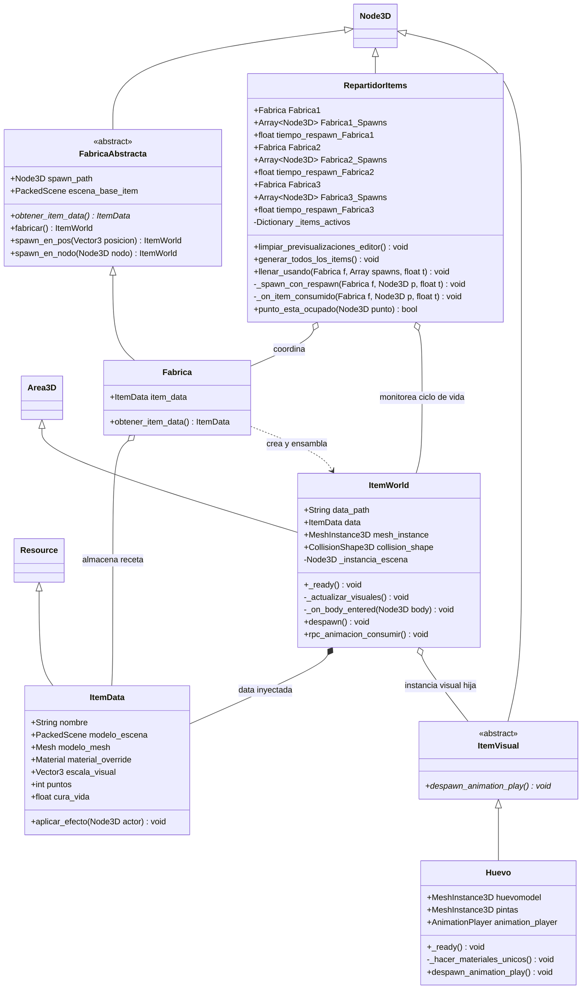
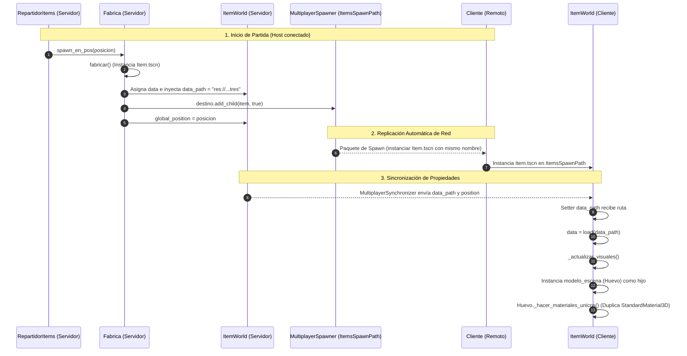
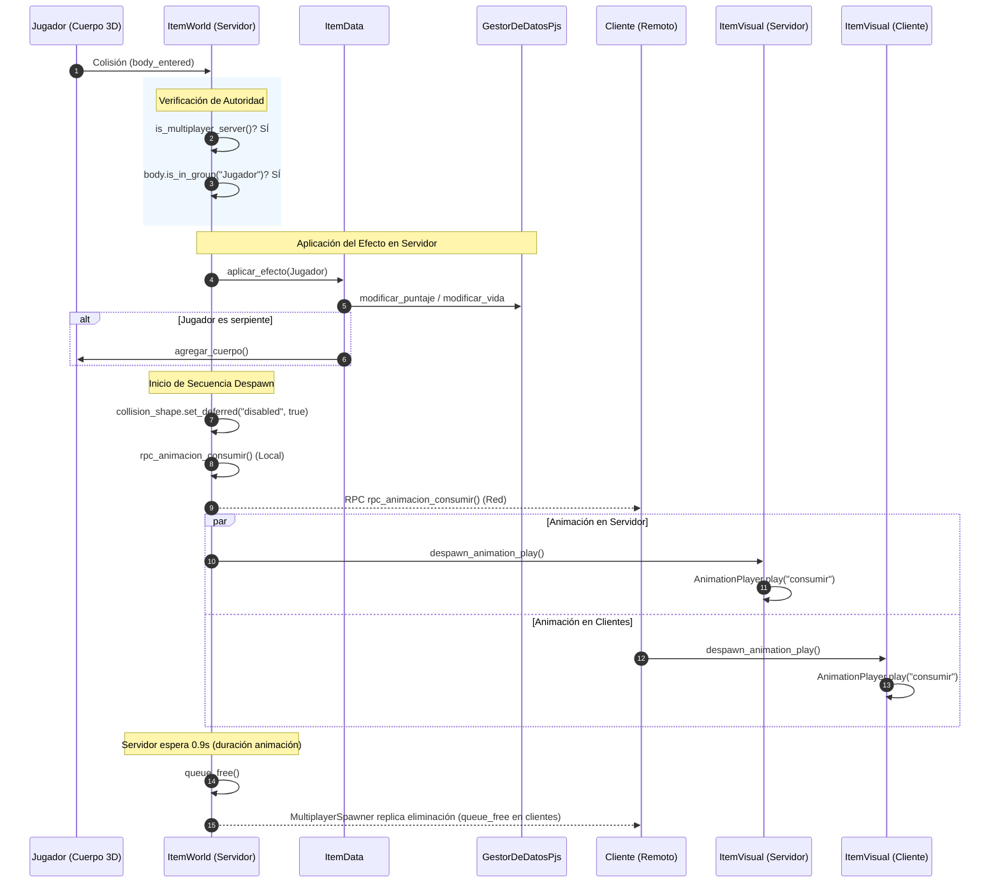
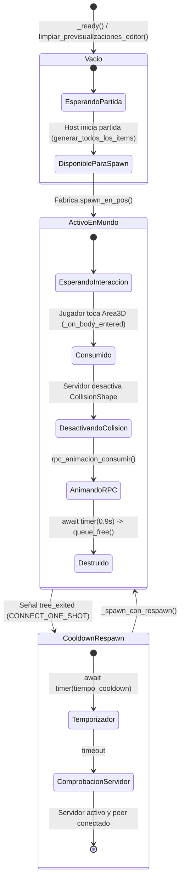

# Arquitectura del Sistema de Fábricas e Ítems en Red (Godot 4)

Este documento detalla la estructura orientada a objetos (UML), el proceso de instanciación distribuida y el control de comportamiento en red de las entidades del juego.

---

## 1. Diagrama de Clases UML (Fábricas, Recursos e Ítems)

El sistema combina tres patrones de diseño:
1. **Abstract Factory / Factory Method:** Desacopla la creación del objeto físico de su configuración de datos.
2. **Flyweight / Data-Driven Design (Resource):** Los datos y la lógica de efectos (`ItemData`) se definen en recursos `.tres` reutilizables.
3. **Composite / Decorator (Visual Polymorphism):** `ItemWorld` funciona como contenedor físico y de red genérico (`Area3D`), mientras que la representación visual y sus animaciones se delegan polimórficamente a `ItemVisual` (`Huevo`).

---

## 2. Diagrama de Secuencia: Instanciación y Sincronización en Red

Muestra el flujo desde que el Servidor decide colocar un ítem hasta que todos los clientes tienen el modelo renderizado con materiales independientes.

---

## 3. Diagrama de Secuencia: Consumo, Animación RPC y Despawn

Ilustra cómo se procesa la física con autoridad de servidor, se despacha la animación a todas las máquinas y se destruye el ítem en red.

---

## 4. Diagrama de Estados: Ciclo de Vida del Ítem y Sistema de Respawn

Muestra los estados por los que transita cada marcador de spawn administrado por `RepartidorItems`.

---

## 5. Resumen de Reglas Clave de Arquitectura

| Aspecto | Implementación | Propósito |
| :--- | :--- | :--- |
| **Punto de Montaje en Red** | `ItemsSpawnPath` (Hijo directo del Spawner) | Requisito estricto de `MultiplayerSpawner` para replicar spawns y despawns automáticos. |
| **Tráfico Cero post-spawn** | `data_path` en `MultiplayerSynchronizer` (`REPLICATION_MODE_NEVER`) | El cliente carga el recurso localmente al nacer. No consume ancho de banda continuo. |
| **Aislamiento de Materiales** | `_hacer_materiales_unicos()` en `huevo.gd` | Clona el material en memoria para que la emisión animada no se propague a otros ítems del mapa. |
| **Seguridad de Efectos** | Colisión validada únicamente con `if multiplayer.is_server():` | Previene que clientes hagan trampa o dupliquen puntuaciones localmente. |
| **Respawn Desacoplado** | Conexión `CONNECT_ONE_SHOT` a `tree_exited` | Evita bucles de sondeo (*polling*) o raycasts continuos; se reactiva solo cuando el ítem realmente desaparece del árbol. |
