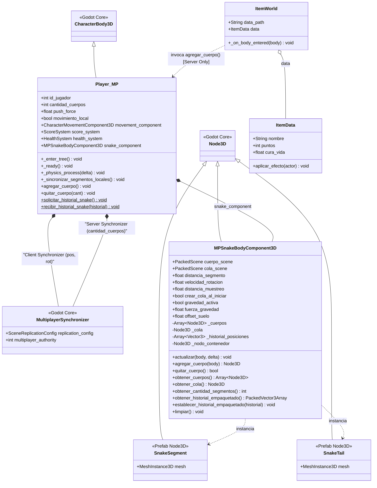
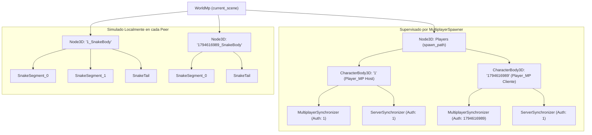
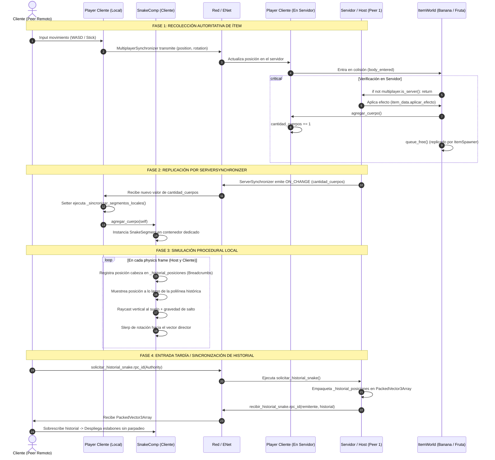

# Arquitectura y Comportamiento en Red del Snake Body System

Este documento detalla la estructura orientada a objetos (UML), la distribución en el árbol de nodos de Godot 4 y el flujo de comunicación y sincronización en red del sistema de cuerpos tipo "Snake".

---

## 1. Diagrama de Clases UML (Estructura de Componentes)

El siguiente diagrama muestra la relación entre el jugador en red (`Player_MP`), su componente de cuerpo (`MPSnakeBodyComponent3D`), los sincronizadores de red y los interactuables del mundo (`ItemWorld` / `ItemData`).

---

## 2. Jerarquía de Árbol de Escenas y Aislamiento de Spawner

Para cumplir con la regla del motor en la que `MultiplayerSpawner` supervisa **exclusivamente a los hijos directos** de su contenedor asignado, los segmentos procedurales del Snake no se instancian dentro de `Players` ni como hijos directos del `CharacterBody3D` (lo cual arrastraría la física y provocaría rotaciones rígidas). En su lugar, se agrupan en un contenedor hermano dedicado (`{PeerID}_SnakeBody`).

---

## 3. Diagrama de Secuencia: Flujo y Comportamiento en Red

El modelo desacopla:
1. **Movimiento/Aiming:** Controlado por el cliente dueño (`MultiplayerSynchronizer`).
2. **Lógica de Juego (Pickups/Daño):** Verificada y ejecutada por el Servidor (`ServerSynchronizer`).
3. **Simulación Cinemática de Eslabones:** Calculada localmente en cada máquina (`MPSnakeBodyComponent3D.actualizar()`).
4. **Despliegue al Conectarse:** Reconciliación de trayectoria mediante RPC ligero (`PackedVector3Array`).

---

## 4. Resumen de Invariantes de Red Implementados

| Aspecto | Implementación Técnica | Beneficio |
| :--- | :--- | :--- |
| **Separación de Autoridades** | `MultiplayerSynchronizer` (Peer ID) + `ServerSynchronizer` (Peer 1) | Permite control reactivo de movimiento sin perder autoridad de servidor en vidas, colisiones y crecimiento. |
| **Ancho de Banda Mínimo** | Solo se replica un entero (`cantidad_cuerpos`) en modo `ON_CHANGE`. | Cero envío continuo de transformaciones de eslabones por red. |
| **Simulación Visual Local** | Cada máquina interpola traslación, slerp y raycast de suelo localmente. | Movimiento orgánico a 60 FPS sin jitter ni desincronización de física. |
| **Alineación de Conexión en Curso** | RPC `solicitar_historial_snake` vía `PackedVector3Array`. | Evita que los cuerpos de jugadores ya existentes aparezcan apilados en el punto de spawn inicial. |
